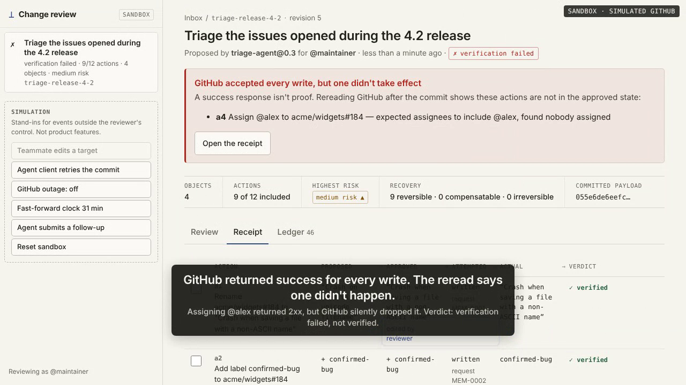

# Backtrack (codename): Phase 0 prototype

A transactional commit layer for writes that AI agents propose to SaaS systems.
**The write you approved is the write that happens, exactly once, with proof.**

"Backtrack" is a codename. It is not clearable as a trademark and must be replaced
before anything ships publicly (see [docs/PRD.md](docs/PRD.md#naming)).

This repository holds the Phase 0 milestone from the PRD: a test agent submits a
grouped change set, a reviewer changes it, the engine binds and commits the approved
payload exactly once under retry, a reread catches a write that returned 2xx without
taking effect, and the receipt proves the resulting state.

[](docs/media/demo.mp4)

*[Watch the 55-second demo](docs/media/demo.mp4). It is recorded from the real UI in sandbox mode with simulated GitHub, and regenerated with `npm run record`.*

## Run the demo

Requires Node 22.18 or later. There are no runtime dependencies.

```sh
npm install        # dev dependencies only (typescript, @types/node, playwright-core)
npm run serve      # web review UI at http://127.0.0.1:4317/, offline sandbox
npm run demo       # the same six beats as a terminal walk-through
npm test           # 86 engine, connector, API, SDK, hook and telemetry tests
npm run test:pack  # packs the tarball, installs it in an empty project, runs `npx bt-demo`
npm run test:e2e   # 11 browser checks of the review UI (needs Chromium; see e2e/review.e2e.ts)
```

## The review UI

`npm run serve` starts a local server (loopback only) with the seeded 12-action change set.
Agents submit more change sets via `POST /api/change-sets`.

- **Inbox:** every transaction with its status, action and object counts, and risk.
- **Review:** the agent's evidence (labeled unverified), then one card per affected issue with a before/after table and its actions. Each action shows its risk, recovery class and the effects that stay even after recovery. You can reject or restore any action, edit its parameters, or open the exact normalized payload. Every change creates a new revision, and edits are refused if they were made against a revision you weren't looking at.
- **Commit approved changes:** a confirmation lists the actions in execution order, the effects that can't be undone, and the payload hash the approval binds to. The UI then approves and commits as two separate recorded events.
- **Conflict:** previewed, current and proposed values side by side, with a rebase button.
- **Receipt:** for each action, the proposed, approved, attempted and actual values plus a verdict. A failed verification is shown in red pencil, and you can select executed actions to propose compensation for them. The receipt stub carries the payload hash, approver, receipt hash and ledger head.
- **Ledger:** the transaction's append-only events, with the hash chain checked.
- **Simulation controls** (sandbox only, labeled as such): a teammate edit, an agent client retry, a GitHub outage, a 31-minute clock jump to expire approvals, a follow-up change set, and a reset.

Keyboard: `j`/`k` move between actions, `x` rejects or restores, `e` edits, `p` shows parameters, `c` commits, `?` shows help. It also works at phone width and in dark mode. Agent text is only ever inserted as text, and the page ships with a strict Content-Security-Policy. POSTs must be same-origin JSON.

`npm run serve -- --repo you/scratch-repo --yes` runs the UI against a disposable real repository instead (it seeds four issues). As with the demo, this has not yet been run against real GitHub.

Against a **disposable** real repository (it creates four issues and writes to them):

```sh
GITHUB_TOKEN=... npm run demo -- --repo you/scratch-repo --yes
# or GitHub App auth: BT_GITHUB_APP_ID, BT_GITHUB_APP_PRIVATE_KEY_FILE, BT_GITHUB_INSTALLATION_ID
```

`npm run build` compiles to `dist/`. `npm pack` produces the package `npx bt-demo …` will run: about 70 kB, zero runtime dependencies, verified by `npm run test:pack`. It stays private, and the product name lives only in `src/brand.ts`, until a public name is cleared.

The demo follows the PRD's demo order:

1. **Grouped review.** 12 proposed actions across 4 issues, with before/after diffs per object, risk and recovery class per action, and agent evidence labeled untrusted. The planted dangerous action closes an issue as a duplicate of a different bug.
2. **Item-level edit/reject.** Edit one title, reject three actions, approve the exact payload hash, commit.
3. **Exactly-once.** The client "times out" and retries both the submit and the commit. It gets the same transaction and the original receipt back, and GitHub receives **0** extra writes.
4. **Verification.** Every write returned 2xx, but one assignee can't be assigned in the repository, so the assignment is dropped. The reread catches it and the transaction ends up `verification_failed`, not `verified`.
5. **Reviewable compensation.** Reverting the title is a new transaction that goes through the same review. It lists the effects it can't remove.
6. **Stale-state gate.** A teammate adds a label between approval and commit. The engine stops before any write, shows previewed/current/proposed side by side, then rebases, gets a new approval and commits.

## Agent SDK

Agents submit change sets and wait for the human decision through a zero-dependency TypeScript client (`src/sdk`):

```ts
import { ReviewClient } from "./src/sdk/index.ts";

const client = new ReviewClient({ baseUrl: "http://127.0.0.1:4317", token: process.env.BT_AGENT_TOKEN });
const { transaction_id } = await client.submit(changeSet);      // validated locally first
const decision = await client.waitForDecision(transaction_id);  // polls until the reviewer is done
if (decision.ok) { /* verified: GitHub is in the approved state */ }
```

- **`ok` is true only for `verified`.** The other outcomes are `not_verified` (committed, but the reread disagrees), `rejected` (with the reviewer's reason), `expired`, `compensated` and `timeout`. Treat every one of them as "the write did not happen as proposed".
- **Fails closed.** The SDK never writes to GitHub; the server executes only what a reviewer approved. An unreachable server throws `SdkError("unreachable")` and nothing is written.
- **Retries are safe.** Resubmitting the identical change set returns the existing transaction (`deduplicated: true`). Use a stable `transaction_id` per logical request.
- **Reviewer edits are visible.** The receipt in `decision.status.receipt` shows proposed vs approved parameters for each action, and `rejected_action_ids` lists what was never sent.
- **Auth.** `serve --agent-token <t>` (or `BT_AGENT_TOKEN`) makes the agent endpoints require `Authorization: Bearer <t>`. The server refuses to listen beyond loopback without one; the reviewer UI has no login yet (roadmap M3).

The same flow from a shell, for agents that aren't written in TypeScript:

```sh
bt-demo submit change-set.json --wait --json   # exit 0 verified · 3 decided, not verified · 4 timeout · 1 error
bt-demo status <transaction-id>                # exit 5 while still waiting
```

`examples/triage-agent.ts` is a complete agent: run `npm run serve`, then `node examples/triage-agent.ts`, and review it in the browser.

Wire format: `POST /api/change-sets` and `GET /api/change-sets/:id`, typed in `src/sdk/protocol.ts`.

## Claude Code hook (experimental)

`bt-demo hook claude-code` is a `PreToolUse` hook that routes Claude Code's GitHub issue writes (`mcp__github__issue_write`, `mcp__github__add_issue_comment`) through review. It always denies the original tool call: on approval, the engine performs the reviewed write and verifies it, and the deny reason tells Claude the outcome. It fails closed on anything it can't handle. Setup and limits are in [`adapters/claude-code/README.md`](adapters/claude-code/README.md), and dogfooding notes go in [`docs/dogfood-log.md`](docs/dogfood-log.md).

## Telemetry (opt-in)

Off by default. `bt-demo telemetry on`, or `--telemetry` for one run, sends anonymous milestone events, so the PRD's validation thresholds (distinct runs, own-repo runs, repeat users) can be counted. No repository names, titles, content or tokens are ever sent. Details are in [`docs/telemetry.md`](docs/telemetry.md).

## What is real and what is simulated

| | Offline mode | Live mode (`--repo`) |
|---|---|---|
| Review, binding, ledger, receipts | real engine | real engine |
| Writes and rereads | in-memory GitHub simulation | GitHub REST API |
| Duplicate retry | real (client retries; engine dedupes) | real |
| Stale-state conflict | real (direct edit outside the engine) | real (direct API edit outside the engine) |
| Verification failure | simulated GitHub behaviour: a non-assignable user is dropped with a 2xx | relies on GitHub dropping a non-assignable assignee (`--unassignable`, default `octocat`). If GitHub assigns the user anyway, the action simply verifies. |

**Live mode has not yet been run against real GitHub.** The REST transport and App
auth are covered by tests that use a fake `fetch`. The first real run against a
disposable repository should happen before anyone outside sees the demo.

## Guarantees and their boundaries

| PRD code | Where | What it does |
|---|---|---|
| G1, G7 | `Engine.submit`, `editAction`, `rejectAction` | One transaction per change set. Every edit or item decision creates a new revision against a fresh read. |
| G2 | `Engine.preview`, `render.ts` | Before/after per object, projected from only the included actions. |
| G3 | `Engine.approve`, `approvedPayload` | Binds reviewer, revision, the canonical payload hash, action ids, expiry and policy version. Any later change invalidates the approval. `approve` refuses a revision the reviewer wasn't looking at. |
| G4 | `Engine.commit` → `#conflicts` | Rereads every target right before execution and compares the fields each action depends on. On any drift nothing executes, the approval is invalidated and a rebase is required. |
| G5 | `Engine.commit` → verification | Rereads after execution and checks the declared postconditions. A 2xx response counts for nothing on its own. |
| G6 | `Engine.proposeCompensation` | Builds the compensation from the prior state captured by the pre-execution reread, undoing only what the action changed. It is a separate transaction that needs its own review. |
| G8 | `Engine.commit`, `#executeAction` | Replays return the stored receipt. After a crash, a resumed run skips actions that the ledger, or a reread showing the postconditions already hold, proves landed. A lost response is resolved by rereading, never by retrying blind. |

How each GitHub operation gets exactly-once is **natural-key reread**. GitHub issue
endpoints take no idempotency key, so set-like fields (title, labels, assignees, state)
are checked by reread before writing. Comments carry a hidden
`<!-- bt-idem:… -->` marker derived from the action's idempotency key, and the engine
looks for that marker before posting. Every receipt records the strategy it used, and
when an operation's strategy is `none` the receipt says exactly-once was not guaranteed.

Other properties:
- **Fail closed:** unknown schema versions, unknown fields at any level, unknown operations or parameters, dependency cycles, and actions that contradict each other are all rejected at intake.
- **Deterministic risk:** closing an issue is high, comments and assignments are medium, metadata edits are low, and touching more than 10 objects raises the batch to high. The contributing factors are always shown.
- **Append-only, hash-chained ledger:** every lifecycle step and every status transition is an event. Events are frozen when appended, and `Ledger.verify` detects later edits to an exported log. Tokens never enter the ledger, and a test checks this.

## Not built yet (Phase 0 remainder and beyond)

- **Multiple reviewers and authentication.** The UI records one configured reviewer identity (`--reviewer`). The PRD scopes roles out of the prototype.
- Durable storage (the engine keeps state in memory) and a database-level commit lock (the current lock only works within one process).
- Webhooks with delivery dedup, and any adapters (LangGraph, Claude Code hook, gateways). The PRD scopes adapters out of the prototype.
- A landing page, telemetry and the paid-pilot waitlist from the validation plan.

## Layout

```
src/engine.ts             intake, revisions, approval binding, commit, verify, compensation, receipts
src/connector.ts          connector contract + postcondition evaluation
src/github/operations.ts  per-operation normalize / risk / recovery / project / postconditions / compensate
src/github/connector.ts   GitHub issue connector (read + write)
src/github/rest.ts        GitHub REST transport;  app-auth.ts  least-privilege App installation tokens
src/github/memory.ts      in-memory GitHub simulation for tests and the offline demo
src/ledger.ts             append-only hash-chained event log
src/state.ts              explicit state-machine transitions
src/validate.ts           fail-closed change-set validation
src/demo/                 seeded 12-action change set and the six-beat demo
src/server/               review API (api.ts), sandbox world + simulation controls, HTTP server
src/sdk/                  agent SDK: ReviewClient, wire protocol, submit/status CLI commands
src/adapters/claude-code/ PreToolUse hook (setup docs in adapters/claude-code/)
src/telemetry/            opt-in telemetry: allowlisted schema, client, reference collector
src/brand.ts              the product name, in one place (codename until the rename)
examples/                 a minimal agent built on the SDK
web/                      review UI: index.html, app.css, app.js (no framework, no build step)
e2e/                      browser walk-through of the review UI
docs/PRD.md               product requirements (v4.1)
```
